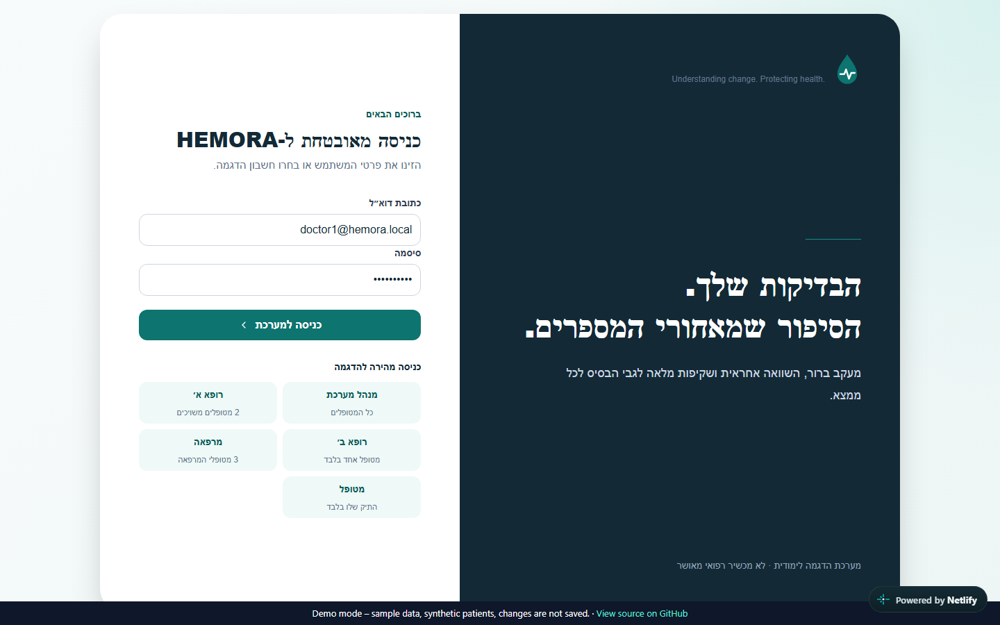
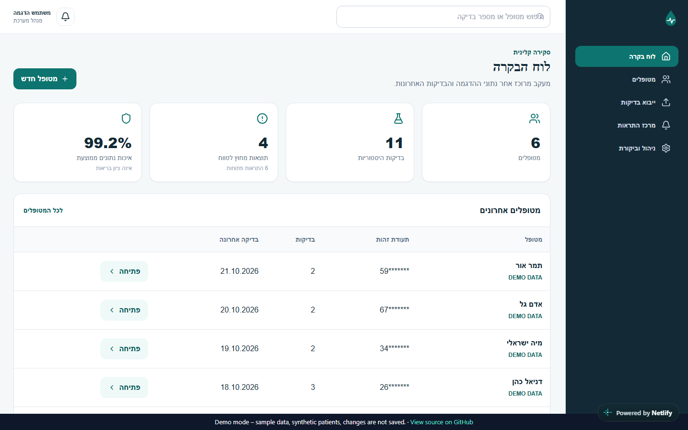
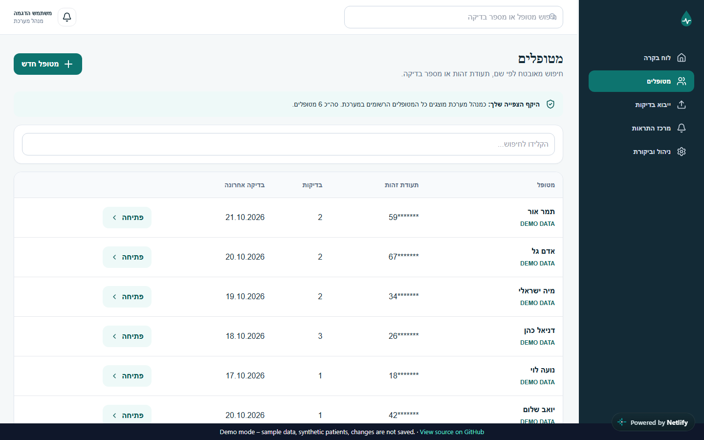
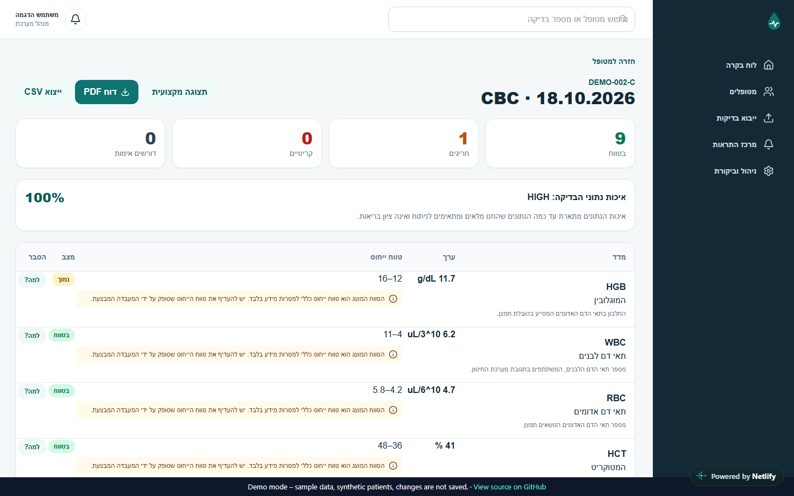
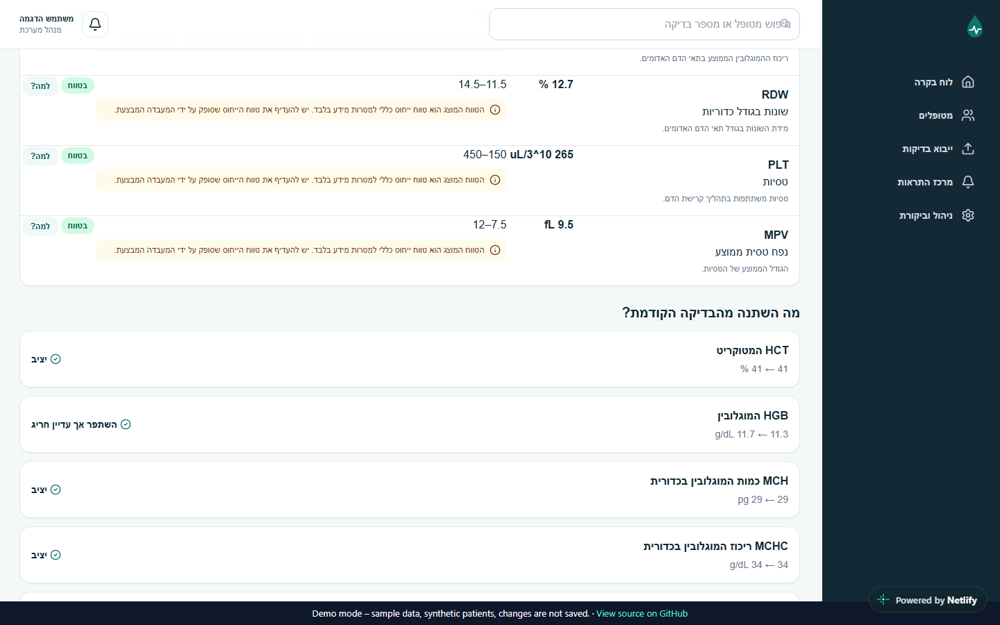
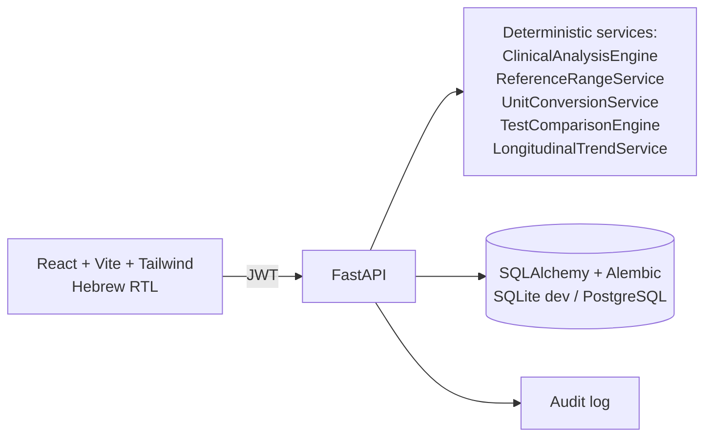

# HEMORA

**Understanding change. Protecting health.**
A Hebrew, right-to-left clinical decision-support prototype for tracking and comparing blood test results over time, with server-enforced access for four roles.


### [▶ Live Demo](https://hemora-demo.netlify.app)

The live demo is a static build that replays responses recorded from the real, seeded backend. Use the quick-login buttons on the login screen to switch between the four roles. Changes are not saved in the demo.

| | |
|---|---|
|  |  |
|  |  |
|  | |

> HEMORA is an educational prototype. It does not diagnose, predict disease or replace a medical professional. All patients are synthetic and marked `DEMO DATA`.

## Features

- Stores patients and their blood-test history.
- Classifies every result against the reference range that applies to it, and shows **where the range came from** (lab range, lab configuration, or a clearly labelled generic demo range).
- Explains each analyte in plain Hebrew and answers "why is HEMORA showing this?" from the stored data.
- Compares each new test with the previous one, analyte by analyte, and reports improved, worsened, stable, newly abnormal or back in range.
- Separates **missing data** from **abnormal data**.
- Imports CSV/XLSX with a preview and explicit confirmation. PDF import is intentionally not implemented, because unverified extraction must not be stored.
- Produces a Hebrew PDF (and CSV) report.
- Admin area: catalogue, users, audit log.

## Roles

| Role | Sees |
|---|---|
| Admin | all patients, catalogue and user management, audit log |
| Doctor | only the patients assigned to them |
| Clinic | only the patients of their clinic |
| Patient | their own record only |

Access is enforced on the server in two functions, `scope_patients` and `assert_patient_access` in `backend/app/api.py`; every endpoint that touches a patient goes through them. Hiding items in the UI is only a convenience: opening another doctor's patient by URL returns 403.

## Architecture



The clinical logic is deterministic and rule-based (no AI), so every classification can be explained and reproduced. "Improved" means closer to the reference range, not simply a higher or lower number.

## Tech stack

| Layer | Technology |
|---|---|
| Backend | FastAPI, SQLAlchemy 2, Alembic, Pydantic 2, pytest |
| Frontend | React 18, TypeScript, Vite, Tailwind, TanStack Query, Recharts, Vitest, Playwright |
| Database | SQLite for local development; PostgreSQL via the Docker Compose file (not yet verified) |
| Auth | Argon2 password hashing, JWT access and refresh tokens, server-side RBAC |
| Reports | ReportLab with bidi support (Hebrew PDF), CSV |
| Packaging | Docker Compose file included (not yet verified end to end) |

## Quick start

Requires Python 3.12+ and Node.js 20+.

```bash
cd backend
python -m venv .venv
# Windows: .venv\Scripts\activate   |   macOS/Linux: source .venv/bin/activate
pip install -r requirements.txt
alembic upgrade head
python -m app.seed
uvicorn app.main:app --reload
```

In a second terminal:

```bash
cd frontend
npm install
npm run dev
```

Open http://localhost:5173. API docs are at http://localhost:8000/docs.

**Docker:** the repository contains a `docker-compose.yml`, but it has **not been verified end to end** yet, so the native setup above is the supported way to run the project. If you try it: `cp .env.example .env && docker compose up --build`.

To build the static demo yourself: `cd frontend && npm run build:demo`. To re-record the fixtures from a running seeded backend: `node scripts/record-demo.mjs`.

## Demo credentials

All users share the password `Hemora123!` (demo only; change it with `DEFAULT_USER_PASSWORD`).

| Role | Email |
|---|---|
| Admin | `admin@hemora.local` |
| Doctor A / B / C | `doctor1@hemora.local`, `doctor2@hemora.local`, `doctor3@hemora.local` |
| Clinic North / Centre | `clinic@hemora.local`, `clinic2@hemora.local` |
| Patient | `patient@hemora.local` |

## Tests

| Layer | Command | Result |
|---|---|---|
| Backend | `cd backend && pytest -q` | 86 passed |
| Frontend | `cd frontend && npm test` | 3 passed |
| Build | `cd frontend && npm run build` | OK |
| E2E (real backend) | `cd frontend && npx playwright test --workers=1` | 10 passed |
| E2E (static demo build, no backend) | `npx playwright test -c playwright.demo.config.ts --workers=1` | 10 passed |

The E2E suite signs in more than ten times a minute, so start the backend with `LOGIN_RATE_LIMIT=200/minute`.

## Security notes

Argon2, short-lived JWTs with refresh tokens, server-side RBAC, login rate limiting, restricted CORS, security headers, parameterised queries, encrypted national ID with a separate HMAC for search, masked display, and an audit log that filters passwords, tokens and full identifiers. No secrets belong in the repository; use `.env`. Details (in Hebrew) are in [`docs/SECURITY_HE.md`](docs/SECURITY_HE.md).

## Documentation

The full Hebrew documentation is in [`docs/`](docs): the original [README](docs/README_HE.md), architecture, database design, clinical logic, security, test plan, user guide and presentation script.

## Roadmap

- Verify `docker compose up --build` end to end in CI.
- Before any use with real data: clinical and regulatory validation, key management, MFA, refresh-token revocation, distributed rate limiting, monitoring, backups and a penetration test.
- English UI.

## License

See [LICENSE](LICENSE).
